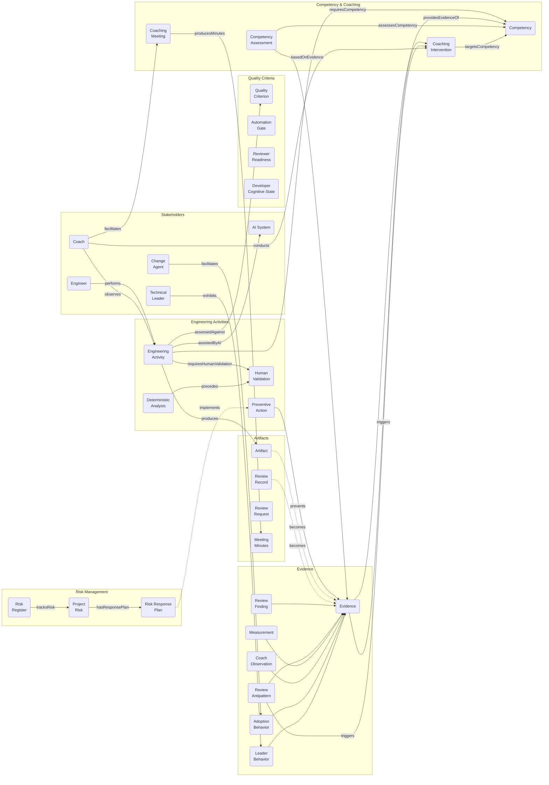

# SECAV-O Coaching Lifecycle, Planning, Risk, Alignment and Ethics Artifacts

This package extends the SECAV-O coaching operating model with six connected governance dimensions:

1. team coaching from team inception / planning / launch, including member preparation and onboarding;
2. annual coaching planning executed through Coaching Sprints;
3. risk management with preventive and corrective actions;
4. explicit alignment between coaching objectives and institutional objectives; and
5. a Code of Ethics for coaches; and
6. formal coach participation in project planning, quality advocacy, documented dissent and proportional escalation when material quality activities are omitted or weakened.

## Changelog

### v0.3.0

Five model extensions integrated into `ontology/secav-o.ttl`, with SHACL shapes, guide updates, and new templates.

**Organizational Change Adoption**
New classes: `AdoptionPillar` (5 subclasses: LeadershipModeling, EfficientCollaboration, OpenCommunication, ContinuousAdaptability, FeedbackAndInnovation), `AdoptionBehavior` (7 subclasses — one per observable behavior from the change adoption matrix), `AdoptionMeasurement` (PulseSurveyMeasurement, DirectRitualObservation), `ChangeAdaptabilityCompetency`, `ChangeAgent`. Properties: `belongsToPillar`, `measuresAdoption`, `facilitatedBy`, `adoptionTarget`. Checklist Group 9 added.

**Coach Observation Model**
New classes: `CoachObservation` (subclass of `Evidence`), `PositiveBehaviorObservation`, `AlertBehaviorObservation`. Properties: `observedDuring`, `observationStatement`, `evidencesCompetency`, `triggersIntervention`. Coach observation checklist connected to ontology terms.

**Technical Leadership Behaviors**
New classes: `TechnicalLeadershipDimension` (3 subclasses: PeopleAndMentoring 35%, ArchitectureAndCode 30%, StrategyAndImpact 35%), `LeaderBehavior` (subclass of `Evidence`) with 10 subclasses (PsychologicalSafetyPromotion, ActiveMentorship, EffectiveDelegation, TechnicalDebtNegotiation, ArchitectureDecisionDocumentation, TeamShielding, DeliveryConsistencyBehavior, ContinuousFeedbackBehavior, TechnicalDiversityBehavior, HolisticProductVisionBehavior), `TechnicalLeader`, `TechnicalLeadershipCompetency`. Property: `belongsToDimension`. Checklist Group 10 added.

**Coaching Meeting & Minutes**
New classes: `CoachingMeeting` (subclass of `CoachingIntervention`), `MeetingMinutes` (subclass of `Artifact`), `MeetingAgreement`. Properties: `producesMinutes`, `hasAgreement`, `agreementOwner`, `agreementDueDate`, `agreementStatus`. Template: `templates/coach-meeting-minutes.md`.

**Software Project Risk Management**
New classes: `ProjectRisk` (4 category subclasses: TechnicalRisk, ManagementRisk, OrganizationalRisk, ExternalRisk), `RiskRegister` (subclass of `Artifact`), `RiskResponseStrategy` (4 subclasses: MitigateStrategy, AvoidStrategy, TransferStrategy, AcceptStrategy), `RiskResponsePlan`. Properties: `tracksRisk`, `hasResponseStrategy`, `hasResponsePlan`, `riskOwner`, `riskProbability` (1–5), `riskImpact` (1–5), `riskScore` (P×I — threshold ≥ 12), `riskRootCause`, `riskEvent`, `riskImpactDescription`, `preventionAction`, `contingencyAction`. SHACL: `ProjectRiskShape` validates P/I scales and requires owner and response plan. Checklist Group 11 added.

**Other changes**
- SHACL shapes added for all new classes; `xsd:` prefix declaration added to `secav-o.shacl.ttl`
- Ontology diagrams in README updated to reflect full v0.3 class hierarchy (core pattern + expanded class hierarchy with 9 subgraph groups)
- Coach observation checklist extended to 11 groups (Groups 9–11 cover adoption, leadership, and risk)

---

### v0.2.0

Added coaching governance extension (`secav-o-coaching-governance-extension.ttl`): annual coaching plan, coaching sprints, sprint retrospectives, institutional alignment, risk management, coach ethics, metrics model, competency growth scale, and formal coach participation in project planning with quality advocacy and escalation protocol.

---

## Ontology Overview

### Core pattern

The diagram below shows the primary relationships between the main classes of `secav-o.ttl`.

### Class hierarchy

```mermaid
graph TD
    subgraph ActH["EngineeringActivity hierarchy"]
        EA2[EngineeringActivity]
        EA2 --> RA2[ReviewActivity]
        EA2 --> PA2[PreventiveAction]
        EA2 --> AIA[AIAssistedActivity]
        EA2 --> DTA[DeterministicAnalysisActivity]
        EA2 --> CIA2[ContinuousIntegrationActivity]
        RA2 --> HVA2[HumanValidationActivity]
        RA2 --> CR2[CodeReview]
        RA2 --> SR2[SelfReview]
        PA2 --> SR2
        PA2 --> ACD[AcceptanceCriteria\nDefinition]
        PA2 --> APC[APIContract\nDefinition]
    end

    subgraph EvH["Evidence hierarchy"]
        Ev2[Evidence]
        Ev2 --> RF2[ReviewFinding]
        Ev2 --> DR2[DefectRecord]
        Ev2 --> RAnt2[ReviewAntipattern]
        Ev2 --> M2[Measurement]
        Ev2 --> RO2[ReviewObservation]
        Ev2 --> CO2[CoachObservation]
        Ev2 --> AB2[AdoptionBehavior]
        Ev2 --> LB2[LeaderBehavior]
        DR2 --> REO[ReviewEscape\nObservation]
        RAnt2 --> CRA[CulturalReview\nAntipattern]
        RAnt2 --> PRA[ProcessReview\nAntipattern]
        RAnt2 --> TRA[TechnicalReview\nAntipattern]
        RAnt2 --> CLRA[ClosureReview\nAntipattern]
        CRA --> PUN[PunitiveReview\nApproach]
        CRA --> NEF[NonEmpathic\nFeedback]
        CRA --> RDC[Reviewer\nDictatorship]
        PRA --> OPR[OversizedPull\nRequest]
        PRA --> OSR[OversizedReview\nSession]
        PRA --> RSA[RubberStamp\nApproval]
        PRA --> SAB[SingleApprover\nBottleneck]
        PRA --> PRR[PrematureReview\nRequest]
        TRA --> MSR[ManualStyle\nReview]
        TRA --> LAD[LateArchitectural\nDiscussion]
        TRA --> HPR[HappyPathOnly\nReview]
        TRA --> IAS[InsufficientAI\nScrutiny]
        CLRA --> MRC[MissingReview\nContext]
        CLRA --> ICL[InfiniteComment\nLoop]
        CO2 --> PBO[PositiveBehavior\nObservation]
        CO2 --> ABO[AlertBehavior\nObservation]
        AB2 --> LDA[LeaderDigital\nToolAdoption]
        AB2 --> PRB[PublicRecognition\nNewBehaviors]
        AB2 --> CDP[Centralized\nDocumentation]
        AB2 --> FSP[FocusedSync\nPractice]
        AB2 --> ETC[EarlyTransparent\nCommunication]
        AB2 --> AGA[Autonomous\nGuideApplication]
        AB2 --> CRF[Constructive\nRetrospective]
        LB2 --> PSP[PsychologicalSafety\nPromotion]
        LB2 --> ACMT[ActiveMentorship]
        LB2 --> EFD[Effective\nDelegation]
        LB2 --> TDN[TechDebt\nNegotiation]
        LB2 --> ADOC[Architecture\nDecision Doc]
        LB2 --> TSH[TeamShielding]
        LB2 --> DCB[DeliveryConsistency]
        LB2 --> CFB[ContinuousFeedback]
        LB2 --> TDB[TechnicalDiversity]
        LB2 --> HPV[HolisticProduct\nVision]
    end

    subgraph QCH["QualityCriterion hierarchy"]
        QC2[QualityCriterion]
        QC2 --> AC2[AcceptanceCriterion]
        QC2 --> AG2[AutomationGate]
        QC2 --> RRd2[ReviewerReadiness]
        QC2 --> DCS2[DeveloperCognitive\nState]
        QC2 --> QAR2[QualityActivity\nRequirement]
        AG2 --> PCH[PreCommitHook]
        AG2 --> STP[StrictTyping\nPolicy]
        AG2 --> CCG[CodeCoverage\nGate]
        RRd2 --> REC[ReviewerEnergy\nCondition]
        RRd2 --> RFC[ReviewerFocus\nCondition]
        DCS2 --> DWC[DeepWork\nCondition]
        DCS2 --> FMC[FatigueManagement\nCondition]
        QAR2 --> ARPC[AIReviewPrompt\nConfiguration]
    end

    subgraph ArtH["Artifact hierarchy"]
        Art2[Artifact]
        Art2 --> DA3[DesignArtifact]
        Art2 --> SCA[SourceCodeArtifact]
        Art2 --> RRec2[ReviewRecord]
        Art2 --> RReq2[ReviewRequest]
        Art2 --> MM2[MeetingMinutes]
        Art2 --> RREG2[RiskRegister]
        DA3 --> ACA[APIContract\nArtifact]
        RReq2 --> FRR[FormalReview\nRequest]
        RReq2 --> DRR[DraftReview\nRequest]
    end

    subgraph CompH["Competency hierarchy"]
        Comp2[Competency]
        Comp2 --> RC2[ReviewCompetency]
        Comp2 --> DC3[DesignCompetency]
        Comp2 --> TC2[TestingCompetency]
        Comp2 --> SC2[SecurityCompetency]
        Comp2 --> PC2[PlanningCompetency]
        Comp2 --> TLC[TechnicalLeadership\nCompetency]
        Comp2 --> CAC[ChangeAdaptability\nCompetency]
    end

    subgraph AdoptH["Adoption Pillars & Measurement"]
        AP[AdoptionPillar]
        AP --> LMP[LeadershipModeling\nPillar]
        AP --> ECP[EfficientCollaboration\nPillar]
        AP --> OCP[OpenCommunication\nPillar]
        AP --> CADP[ContinuousAdaptability\nPillar]
        AP --> FAP[FeedbackAndInnovation\nPillar]
        AM2[AdoptionMeasurement]
        AM2 --> PSM[PulseSurvey\nMeasurement]
        AM2 --> DRO[DirectRitual\nObservation]
    end
    M2 --> AM2

    subgraph LeadH["Leadership Dimensions"]
        TLD[TechnicalLeadership\nDimension]
        TLD --> PMD[PeopleAndMentoring\nDimension]
        TLD --> ACHDIM[ArchitectureAndCode\nDimension]
        TLD --> SID[StrategyAndImpact\nDimension]
    end

    subgraph RiskH["Risk Management"]
        PR2[ProjectRisk]
        PR2 --> TECHR[TechnicalRisk]
        PR2 --> MNGR[ManagementRisk]
        PR2 --> ORGR[OrganizationalRisk]
        PR2 --> EXTR[ExternalRisk]
        RRS[RiskResponseStrategy]
        RRS --> MIT[MitigateStrategy]
        RRS --> AVO[AvoidStrategy]
        RRS --> TRS[TransferStrategy]
        RRS --> ACCS[AcceptStrategy]
        RRP2[RiskResponsePlan]
    end

    subgraph MtgH["Meetings & Agreements"]
        CMT2[CoachingMeeting]
        MA[MeetingAgreement]
    end
    CMT2 --> MM2
    MM2 --> MA
```

## Core cycle

Institutional / Project Objectives -> Project Planning & Quality Governance -> Team Inception & Launch -> Member Preparation -> Initial Baselines -> Annual Coaching Plan -> Risk Plan -> Coaching Sprint -> Evidence & Metrics -> Coaching Intervention -> Sprint Retrospective -> Risk Review -> Replanning -> Competency Trend -> New-Member Onboarding -> Institutional Alignment Review

## Included artifacts

### Glossary
- `coaching-governance/glossary/glossary.md` — authoritative definitions for all terms introduced or specialized by the framework: calidad mínima razonable, módulo crítico, inspección formal, revisión de pares, observador silencioso, asistente de calidad, principios FIRST, patrón AAA/GWT, BVA, phaseInjected/phaseDetected/detectionMethod, tasa de escape, Fail Fast, PoC, trazador de extremo a extremo, Go/Pivot/Stop, sprint de coaching, ImprovementAction, QualityPlanningConcern, acción preventiva/correctiva, and more. 30 entries across 8 thematic sections.

### Operating model
- `coaching-governance/docs/coach-role-profile.md` — authoritative role profile for the SECAV-O coach: nine activity domains (quality mastery, instruction/feedback, design promotion, quality planning, metrics, architecture support, AI adoption governance, audit collaboration, facilitation), SECAV-O mapping, and role boundaries.
- `coaching-governance/docs/project-planning-participation.md` — coach participation in project planning, quality-gate advocacy, formal dissent and escalation.
- `coaching-governance/docs/team-coaching-lifecycle.md` — coaching from team inception/launch through member preparation, baseline establishment and ongoing onboarding.
- `coaching-governance/docs/coaching-cycle.md` — annual planning, sprint execution, retrospectives and replanning.
- `coaching-governance/guides/requirements-inspection.md` — formal inspection of requirements documents: why multiple reviewers are essential (ambiguity can only be detected by comparing independent interpretations), six types of requirements defects, five-phase inspection process, coach as silent observer with post-session feedback.
- `coaching-governance/guides/retrospective-participation.md` — coach role in sprint retrospectives: facilitates when no Scrum Master is present; acts as silent observer when one is. In both modes, verifies that defect and quality data is analyzed and that concrete improvement actions are agreed. Post-session feedback: group, individual, or organizational escalation as needed.
- `coaching-governance/guides/defect-tracking.md` — coach closes bug tickets in the tracking system (Jira etc.) to collect consistent defect metrics (`secavo:DefectObservation`, `secavo:phaseInjected`, `secavo:phaseDetected`). When the coach is overloaded, a team member can be designated as Quality Assistant after training and under monitored supervision; the assistant role is also a coaching and competency development opportunity.
- `coaching-governance/guides/risk-management.md` — coaching risk-management model.
- `coaching-governance/guides/incremental-adoption.md` — strategic guide for incremental framework adoption using the Fail Fast philosophy: PoC, end-to-end tracer, short feedback loops, Go/Pivot/Stop decision criteria, and phased expansion from PoC to organization-wide adoption.
- `coaching-governance/docs/institutional-alignment.md` — method for connecting individual coaching objectives to institutional objectives.
- `coaching-governance/docs/coach-code-of-ethics.md` — SECAV-O Code of Ethics for coaches.
- `coaching-governance/docs/coach-committee.md` — governance model for multi-coach organizations: Coach Committee structure, Lead Coach designation (by management or coach consensus), committee responsibilities, assignment matrix, escalation, and proposed ontology extension.
- `coaching-governance/docs/metrics-model.md` — defects, reviews, inspections, unit tests and competency-growth metrics.
- `coaching-governance/docs/competency-growth-scale.md` — longitudinal competency maturity scale.
- `coaching-governance/guides/peer-review-sessions.md` — coach observation protocol during peer reviews: coach attends as silent note-taker only (no verbal participation), product-focused review culture, silent observation when team loses focus, and pending-point procedure for unresolved disagreements (mark pending → continue → escalate to Project Leader after the session).
- `coaching-governance/guides/formal-inspections.md` — structured formal inspections of critical system modules: architect identifies critical modules by risk criteria, coach moderates the inspection process (planning → individual preparation → inspection meeting → rework → follow-up), Technical Lead and management provide support. Outputs map to `secav:ReviewRecord`, `secav:ReviewFinding`, and `secav:CompetencyAssessment`.
- `coaching-governance/guides/project-kickoff-alignment.md` — pre-project alignment meeting between the Technical Lead, Coach, and senior management: establishing few but measurable project success objectives (at least one quality/defect metric required), team objectives (may be more aggressive), individual objectives, and the coach's role in preventing goal dilution.
- `coaching-governance/guides/coach-team-behaviors.md` — team leader behaviors the coach observes: facilitation vs. protagonist role, consensus-based decision-making, building plans the team genuinely believes in, participatory risk management, capability-based work assignment, and respectful team culture. Includes a per-sprint observation checklist and SECAV-O mapping from observed behaviors to coaching interventions.
- `coaching-governance/guides/design-documentation-standards.md` — mandatory design artifacts by system characteristic. Currently covers state diagrams: required whenever an entity has distinguishable states and state-dependent behavior; must include explicit initial and final states, all reachable states, labeled transitions (event/condition), guards, and transition actions. Absence or incompleteness is a blocking `secav:ReviewFinding`. Coach observes as silent observer; documents systemic absence of diagrams as `secavo:QualityPlanningConcern`.
- `coaching-governance/guides/minimum-quality-criteria.md` — unifying principle: inspecting the critical artifacts of each productive phase is the minimum quality bar for reasonable software quality. Maps all development phases (requirements, architecture/detailed design, code, unit test design, system test design, acceptance test design) to their SECAV-O activity and artifact types, inspection guide, and criteria for selecting which artifacts warrant formal inspection. Identifies which phases still lack dedicated guides. Establishes the phase-advance criterion: critical findings must be resolved and verified by the coach before work progresses.
- `coaching-governance/guides/unit-test-review.md` — checklist and guide for unit test design review: FIRST principles as quality criteria, boundary value analysis, null/undefined, time/date, exception, and injection case coverage, AAA/GWT structure, mock discipline, and naming conventions. Coach attends as silent observer; post-session feedback (group, individual, or organizational). Full SECAV-O mapping: `secav:UnitTestDesignReview`, `secav:UnitTestDesignArtifact`, `secav:TestingCompetency`, `secav:TestResult`, `secav:ReviewFinding`.
- `coaching-governance/guides/code-review-best-practices.md` — evidence-based best practices for code review, covering reviewer and author responsibilities, feedback culture, AI-assisted code, and integration with coaching evidence.
- `coaching-governance/guides/ai-assisted-code-review.md` — guidance for reviewing AI-assisted code and using AI tools in the review pipeline, including risk triage, false-positive management, data privacy, and SECAV-O integration.

### Templates
- `templates/project-planning-quality-gate-review.md` — planning-time review of required quality activities and evidence.
- `templates/quality-planning-dissent-and-escalation.md` — formal quality concern, dissent, management response and escalation record.
- `templates/team-launch-coaching-plan.md` — launch/planning artifact for team objectives, project context, risks, member preparation and initial coaching baselines.
- `templates/member-preparation-checklist.md` — readiness checklist before team launch.
- `templates/new-member-onboarding.md` — structured onboarding for members joining after launch, including project context, objectives, risks and growth baseline.
- `templates/annual-coaching-plan.md` — annual plan with institutional alignment and annual risk plan.
- `templates/coaching-sprint-plan.md` — sprint planning/replanning, including sprint risk review.
- `templates/sprint-retrospective.md` — retrospective with objective, metric and risk follow-up.
- `templates/risk-register.csv` — risk register including probability, impact, preventive and corrective actions.
- `templates/institutional-alignment-matrix.csv` — mapping between institutional and coaching objectives.
- `templates/coach-ethics-acknowledgement.md` — acknowledgement of coaching ethics obligations.
- `templates/coach-committee-charter.md` — charter template for the Coach Committee: members, Lead Coach designation, decision rules, assignment matrix, conflict-of-interest declarations, and ethics acknowledgement tracking.
- `templates/engineer-coaching-assessment.md` — coaching assessment/evidence template.
- `templates/engineer-development-record.md` — **(proposal)** longitudinal engineer development record spanning multiple cycles and coaches, with competency tracking, session log, 360 feedback, coach handoffs, and organizational indicators.
- `templates/organizational-competency-view.csv` — **(proposal)** aggregated organizational view: one row per engineer per cycle, enabling team-level competency averages, objective progress, and promotion/retention risk flags.
- `examples/example-engineer-development-record.md` — **(proposal)** fully completed example of the engineer development record (fictional engineer Valeria Montes, including a coach change in July).
- `templates/metrics-register.csv` — metric collection register.
- `templates/defect-log.csv` — defect phase-injected / phase-detected log.
- `templates/rca-defect-analysis.md` — Root Cause Analysis (RCA) template for P1/P2 defects: environment metadata, impact summary, software lifecycle timeline, 5-Whys engineering analysis, SMART corrective action plan, systemic preventive actions, and coaching intervention. Links SECAV-O antipattern classes to root-cause categories.
- `templates/competency-trend.csv` — competency progression tracker.
- `templates/coaching-backlog.csv` — coaching improvement-action tracker.

### Machine-readable artifacts
- `schemas/project-planning-governance.schema.json` — machine-readable project-planning quality-governance record.
- `examples/example-quality-planning-escalation.yaml` — worked dissent/escalation example.
- `schemas/team-coaching-lifecycle.schema.json` — JSON Schema for team launch/preparation/onboarding records.
- `examples/example-team-launch-and-onboarding.yaml` — worked lifecycle example.
- `ontology/secav-o-coaching-governance-extension.ttl` — OWL-aligned extension for planning, risks, alignment, ethics, metrics and retrospectives.
- `ontology/alignment-matrix.csv` — explicit mapping between extension terms and SECAV-O core concepts.
- `validation/secav-o-coaching-governance.shacl.ttl` — SHACL constraints for annual plans, objectives, risks, retrospectives and ethics acknowledgements.
- `schemas/coaching-sprint.schema.json` — JSON Schema for coaching sprint records with alignment and risk fields.
- `examples/example-coaching-sprint.yaml` — worked example.

## Governance principles

- Coaching objectives should be traceable to an institutional, team, quality, engineering, security, workforce, or learning objective where appropriate.
- Risk management is part of the annual plan and is reviewed during every sprint retrospective.
- Each risk records probability, impact, preventive actions, corrective/contingency actions, owner, status and review history.
- Coaching metrics are evidence for improvement, not instruments for punishment or isolated performance ranking.
- Coaches must protect confidentiality, avoid conflicts of interest, distinguish evidence from opinion, and preserve engineer dignity and professional autonomy.

## Core artifacts

The SECAV-O core ontology files that this extension builds on:

- `ontology/secav-o.ttl` — core ontology: engineering activities, artifacts, competencies, evidence, measurement, AI assistance, human validation, assessment, and coaching concepts.
- `validation/secav-o.shacl.ttl` — SHACL constraints for the core ontology.
- `examples/design-review.ttl` — worked example: AI-assisted design review instance.

## Claim boundary

These artifacts define an operating and governance model. They do not claim that the metrics are validated predictors of engineer performance, that any numeric target is universally appropriate, or that SECAV-O has been independently validated, standardized, or adopted by third parties.

The engineer development record example (Valeria Montes) is entirely fictional and serves only as a template illustration. Templates and example files are not evidence of adoption or measured outcomes. The pilot protocol (`pilot/pilot-protocol.md`) describes a planned future validation activity, not a completed one.

## Ontology alignment note

Version 0.3.0 explicitly aligns coaching governance with the SECAV-O core pattern: Engineering Activity → Artifact → Competency → Acceptance Criterion → Evidence/Measurement → Coaching Intervention. Baselines, observations and competency trends are modeled as Evidence; ImprovementAction is modeled as a CoachingIntervention specialization; CoachingObjectives target Competencies; CoachingSprints observe EngineeringActivities and collect Artifact/Evidence/Metric information.

The extension uses the stable namespace `https://github.com/vlorenzana/software-engineering-coaching-framework/ontology/secav-o-coaching-governance#` and formally imports the core ontology via `owl:imports`. Core classes are referenced using the `secav:` prefix; extension-specific classes use the `secavo:` prefix.

## Planning participation and quality advocacy

Version 0.2.0 adds a formal governance role for the coach in project planning. The recommended model gives the coach an explicit voice in planning and, when granted by the adopting organization, a vote on decisions that materially affect quality, competency development and human validation. The coach can raise a documented quality-planning concern when reviews, peer reviews, inspections, unit-test activities or other material quality controls are omitted or weakened. If the residual risk remains material, the coach can record formal dissent and escalate through the defined management chain. SECAV-O does not create legal or managerial authority by itself and does not assume a universal veto right; actual decision rights are defined by each adopting organization.
